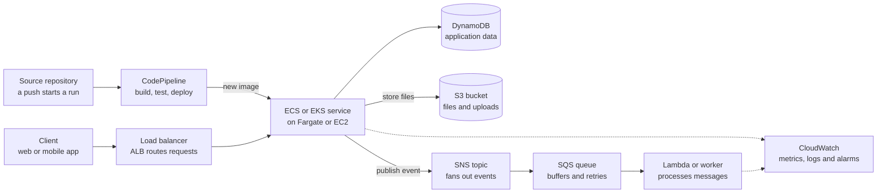

# AWS and Kubernetes Interview Prep

## 1. How the services fit together

Most backends built on these services share one shape: a synchronous request path, an asynchronous path for slow work, and a delivery pipeline and monitoring layer around both.



Interviewers often ask you to draw this for a project you worked on. Be ready to say why each arrow exists: the queue absorbs spikes and retries failures, the topic lets several consumers react to one event, and the database and bucket hold state so the containers stay stateless.

## 2. EC2

EC2 gives you virtual machines that you size, patch and scale yourself: the most control of any compute option, and the most operational work.

| Concept | What to know |
| --- | --- |
| AMI | The image an instance boots from: operating system plus preinstalled software |
| Instance type | Family and size, such as `t3.micro`. T is burstable, M general purpose, C compute, R memory |
| EBS volume | Network block storage that persists independently of the instance; tied to one Availability Zone |
| Instance store | Local disk on the host: very fast, but the data is lost when the instance stops |
| Security group | A stateful firewall on the instance; allow rules only |
| Instance profile | The IAM role attached to an instance, giving it temporary credentials |
| User data | A script that runs on first boot, used for bootstrapping |
| Elastic IP | A static public IPv4 address you can move between instances |

### Pricing options

| Option | Commitment | Typical saving | Best for |
| --- | --- | --- | --- |
| On-Demand | None | None | Unpredictable or short-lived workloads |
| Savings Plans, Reserved Instances | 1 or 3 years | Up to about 72% | A steady baseline that always runs |
| Spot | None; AWS can reclaim with a two-minute warning | Up to about 90% | Fault-tolerant batch jobs and stateless workers |
| Dedicated Hosts | Optional | None | Licensing or compliance that needs a physical server |

### Scaling and load balancing

- An Auto Scaling group keeps between a minimum and maximum number of instances running across several Availability Zones, and replaces unhealthy ones.
- Target tracking is the usual scaling policy: "keep average CPU at 50%". Step and scheduled policies cover the rest.
- Scaling out (more instances) is horizontal. Scaling up (a bigger instance) is vertical and needs a restart.

| Load balancer | Layer | Use it for |
| --- | --- | --- |
| Application Load Balancer | 7: HTTP, HTTPS, gRPC | Routing by path or host name; targets can be instances, IPs or Lambda |
| Network Load Balancer | 4: TCP, UDP | Extreme throughput, static IPs, non-HTTP protocols |
| Gateway Load Balancer | 3 | Putting firewalls and other appliances in the traffic path |

### Interview points

- Stop keeps the EBS volumes and stops compute charges. Terminate deletes the instance and, by default, its root volume.
- A security group is stateful and attached to an instance. A network ACL is stateless, attached to a subnet, and supports deny rules.
- High availability means at least two Availability Zones: an Auto Scaling group behind a load balancer.
- Never put access keys on an instance. Attach a role, and the SDK picks up rotating credentials from the instance metadata service.
- Reach private instances with Systems Manager Session Manager instead of SSH keys and a bastion host.
- If an instance is unreachable, check in order: security group, network ACL, route table, public IP, then the status checks.

## 3. Docker

Docker packages an application and everything it needs into an image, and runs that image as an isolated process called a container.

| Term | Meaning |
| --- | --- |
| Image | A read-only template built in layers from a Dockerfile |
| Container | A running instance of an image, with its own file system, network and process tree |
| Dockerfile | The recipe that builds an image |
| Registry | Where images are stored and pulled from: ECR, Docker Hub |
| Tag | A name for one version of an image, such as `orders-api:1.4.2` |
| Volume | Storage that outlives the container |

|  | Container | Virtual machine |
| --- | --- | --- |
| Isolation | Shares the host kernel; isolated by namespaces and cgroups | Its own full operating system |
| Size | Megabytes | Gigabytes |
| Startup | Seconds or less | Minutes |

### A multi-stage Dockerfile for a Go service

```dockerfile
# Stage 1: build with the full Go toolchain
FROM golang:1.27 AS build
WORKDIR /src
COPY go.mod go.sum ./
RUN go mod download            # cached until go.mod or go.sum changes
COPY . .
RUN CGO_ENABLED=0 go build -o /app ./cmd/api

# Stage 2: ship only the binary
FROM gcr.io/distroless/static-debian12
COPY --from=build /app /app
USER nonroot
EXPOSE 8080
ENTRYPOINT ["/app"]
```

### Commands

| Command | Purpose |
| --- | --- |
| `docker build -t orders-api:1.4.2 .` | Build an image from the Dockerfile in this directory |
| `docker run -d -p 8080:8080 --name api orders-api:1.4.2` | Run in the background, mapping host port to container port |
| `docker ps -a` | List containers, including stopped ones |
| `docker logs -f api` | Follow a container's output |
| `docker exec -it api sh` | Open a shell inside a running container |
| `docker stop api` | Send SIGTERM, then SIGKILL after 10 seconds |
| `docker push <registry>/orders-api:1.4.2` | Upload the image to a registry |
| `docker compose up -d` | Start a multi-container setup for local development |

### Interview points

- Each Dockerfile instruction creates a cached layer. Put what changes least first, which is why `go.mod` is copied before the source.
- A multi-stage build leaves the compiler behind, giving an image of a few megabytes that pulls faster and has less to attack.
- `ENTRYPOINT` sets the executable and `CMD` supplies default arguments that `docker run` can override.
- Prefer `COPY` to `ADD`. `ADD` also unpacks archives and fetches URLs, which is rarely wanted.
- Use the exec form, `ENTRYPOINT ["/app"]`, so your process is PID 1 and receives SIGTERM for graceful shutdown.
- Run as a non-root user, and never bake secrets into an image, because every layer is kept.
- A `.dockerignore` file keeps `.git`, local binaries and secrets out of the build context.
- Containers are disposable. Keep state in a volume or an external store such as S3 or DynamoDB.
- Memory and CPU limits are enforced through cgroups. Since Go 1.25, `GOMAXPROCS` follows the container's CPU limit automatically.
- Docker builds and runs containers on one host. ECS and Kubernetes schedule, restart, scale and roll them out across many.

## 4. ECS

ECS is AWS's own container orchestrator: you describe a container in a task definition, and a service keeps the requested number of copies running.

| Concept | Meaning |
| --- | --- |
| Cluster | A logical group of capacity (Fargate or EC2 instances) where tasks run |
| Task definition | A versioned blueprint: image, CPU and memory, ports, environment, secrets, logging, roles |
| Task | One running copy of a task definition, holding one or more containers |
| Service | Keeps N tasks running, replaces failed ones, registers them with a load balancer, and rolls out new versions |
| ECR | The registry where your container images are stored |

### Fargate vs EC2 launch type

|  | Fargate | EC2 |
| --- | --- | --- |
| Servers | None to manage | You patch, scale and pay for the instances |
| Billing | Per second for the CPU and memory each task requests | Per instance, whether tasks fill it or not |
| Best for | Most services, spiky or unpredictable load | Steady high utilization, GPUs, special instance types |
| Trade-off | Higher price per unit of compute | More operational work |

### A task definition

```json
{
  "family": "orders-api",
  "networkMode": "awsvpc",
  "requiresCompatibilities": ["FARGATE"],
  "cpu": "512",
  "memory": "1024",
  "executionRoleArn": "arn:aws:iam::123456789012:role/ecsTaskExecutionRole",
  "taskRoleArn": "arn:aws:iam::123456789012:role/orders-api-task",
  "containerDefinitions": [
    {
      "name": "api",
      "image": "123456789012.dkr.ecr.ap-south-1.amazonaws.com/orders-api:1.4.2",
      "portMappings": [{ "containerPort": 8080 }],
      "environment": [{ "name": "LOG_LEVEL", "value": "info" }],
      "secrets": [{ "name": "DB_PASSWORD", "valueFrom": "arn:aws:secretsmanager:ap-south-1:123456789012:secret:orders/db" }],
      "logConfiguration": {
        "logDriver": "awslogs",
        "options": {
          "awslogs-group": "/ecs/orders-api",
          "awslogs-region": "ap-south-1",
          "awslogs-stream-prefix": "api"
        }
      }
    }
  ]
}
```

### The two roles

| Role | Used by | Typical permissions |
| --- | --- | --- |
| Task execution role | The ECS agent, before your code starts | Pull the image from ECR, write logs to CloudWatch, read the secrets listed in the task definition |
| Task role | Your application code | Whatever the app calls: DynamoDB, SQS, S3 |

### Interview points

- In `awsvpc` mode every task gets its own network interface, private IP and security group, and the load balancer targets task IPs directly.
- Service auto scaling uses target tracking on CPU, memory, requests per target, or a custom metric such as queue depth.
- A rolling deployment is tuned by minimum healthy percent and maximum percent. The deployment circuit breaker rolls back automatically if new tasks keep failing.
- Blue/green deployments start a full new set of tasks, shift traffic, and keep the old set for a fast rollback.
- On stop, ECS sends SIGTERM and then SIGKILL after the stop timeout, 30 seconds by default. Your Go service must handle SIGTERM to finish in-flight requests.
- Tasks restarting? Check the stopped reason and exit code: 137 usually means out of memory, and failed health checks or image pull errors are the other common causes.
- Pass secrets through the `secrets` field from Secrets Manager or Parameter Store, never as plain environment values.
- ECS Exec opens a shell in a running container for debugging, without SSH.

## 5. Kubernetes and EKS

Kubernetes runs containers by constantly reconciling the cluster's actual state with the desired state you declare in YAML, and EKS is AWS running the Kubernetes control plane for you.

### Architecture

| Component | Runs on | Job |
| --- | --- | --- |
| API server | Control plane | The front door: `kubectl` and every controller talk to it |
| etcd | Control plane | The key-value store that holds all cluster state |
| Scheduler | Control plane | Chooses a node for each new pod |
| Controller manager | Control plane | Runs the reconcile loops for Deployments, ReplicaSets and nodes |
| kubelet | Every node | Starts and watches the pods assigned to its node |
| kube-proxy | Every node | Sets up network rules so a Service reaches its pods |
| Container runtime | Every node | Actually runs the containers; usually containerd |

### Objects you must know

| Object | Purpose |
| --- | --- |
| Pod | The smallest unit: one or more containers sharing a network address and volumes |
| Deployment | Stateless apps; manages ReplicaSets to give rolling updates and rollbacks |
| StatefulSet | Stateful apps that need stable pod names and their own persistent storage |
| DaemonSet | One pod on every node, for log shippers and monitoring agents |
| Job, CronJob | Work that runs to completion, once or on a schedule |
| Service | A stable virtual IP and DNS name in front of a changing set of pods |
| Ingress | HTTP routing from outside the cluster to Services |
| ConfigMap, Secret | Configuration and sensitive values injected as environment variables or files |
| Namespace | A logical partition for teams or environments |
| HorizontalPodAutoscaler | Changes the replica count based on CPU, memory or custom metrics |

### A Deployment and its Service

```yaml
apiVersion: apps/v1
kind: Deployment
metadata:
  name: orders-api
spec:
  replicas: 3
  selector:
    matchLabels:
      app: orders-api
  strategy:
    type: RollingUpdate
    rollingUpdate:
      maxSurge: 1        # one extra pod during a rollout
      maxUnavailable: 0  # never drop below 3 ready pods
  template:
    metadata:
      labels:
        app: orders-api
    spec:
      containers:
        - name: api
          image: 123456789012.dkr.ecr.ap-south-1.amazonaws.com/orders-api:1.4.2
          ports:
            - containerPort: 8080
          resources:
            requests: { cpu: 250m, memory: 256Mi }  # used by the scheduler
            limits: { memory: 512Mi }               # enforced at runtime
          readinessProbe:
            httpGet: { path: /ready, port: 8080 }
          livenessProbe:
            httpGet: { path: /health, port: 8080 }
          envFrom:
            - configMapRef: { name: orders-config }
---
apiVersion: v1
kind: Service
metadata:
  name: orders-api
spec:
  selector:
    app: orders-api   # finds pods by label
  ports:
    - port: 80
      targetPort: 8080
```

### Probes and Service types

| Probe | When it fails |
| --- | --- |
| Liveness | The container is restarted |
| Readiness | The pod is removed from the Service until it passes again; no restart |
| Startup | Holds back the other two probes until a slow app has started |

| Service type | Reachable from |
| --- | --- |
| ClusterIP (default) | Inside the cluster only |
| NodePort | A fixed port on every node's IP |
| LoadBalancer | A cloud load balancer; on EKS, an NLB |

### Commands for debugging

| Command | Use |
| --- | --- |
| `kubectl get pods -n <ns> -o wide` | List pods with status, restarts and node |
| `kubectl describe pod <pod>` | Events: scheduling, image pulls, probe failures |
| `kubectl logs <pod> --previous` | Logs of the container that just crashed |
| `kubectl exec -it <pod> -- sh` | A shell inside the container |
| `kubectl rollout status deployment/<name>` | Watch a rollout |
| `kubectl rollout undo deployment/<name>` | Go back to the previous version |
| `kubectl top pods` | Current CPU and memory use |

| Pod status | Usual cause |
| --- | --- |
| Pending | No node fits: not enough CPU or memory, a taint, or an unbound volume |
| ImagePullBackOff | Wrong image name or tag, or no permission to pull |
| CrashLoopBackOff | The app keeps exiting; read the previous logs |
| OOMKilled | The container exceeded its memory limit |
| Running but not Ready | The readiness probe is failing |

### What EKS adds

- AWS runs and patches the control plane across several Availability Zones. You supply the nodes: managed node groups, Fargate, or EKS Auto Mode.
- Pods get AWS permissions through IAM Roles for Service Accounts or EKS Pod Identity, which play the part of an ECS task role.
- The AWS Load Balancer Controller creates an ALB for an Ingress and an NLB for a LoadBalancer Service.
- The VPC CNI plugin gives every pod a real VPC IP address.
- Karpenter or the Cluster Autoscaler adds and removes nodes; the HPA adds and removes pods.

### Interview points

- Requests decide where a pod is scheduled. Limits are enforced: excess CPU is throttled, excess memory gets the container killed.
- A Service finds its pods through a label selector, so a label mismatch is the first thing to check when it has no endpoints.
- A Secret is only base64-encoded by default. Enable encryption at rest, or load secrets from AWS Secrets Manager.
- On shutdown the pod receives SIGTERM and has `terminationGracePeriodSeconds`, 30 by default, before SIGKILL.
- Taints keep pods off a node unless they tolerate it; affinity rules attract pods to nodes or to each other.
- A PodDisruptionBudget limits how many pods can be down at once during node drains and upgrades.

## 6. Lambda

Lambda runs a function in response to an event and bills per millisecond of execution, with no servers to manage and nothing running between invocations.

### Three invocation models

| Model | Typical sources | Does the caller wait? | On failure |
| --- | --- | --- | --- |
| Synchronous | API Gateway, ALB, function URL | Yes | The error goes back to the caller, who decides whether to retry |
| Asynchronous | S3, SNS, EventBridge | No; Lambda queues the event | Lambda retries twice, then sends the event to a dead-letter queue or failure destination |
| Poll-based (event source mapping) | SQS, Kinesis, DynamoDB Streams | Lambda polls and invokes with a batch | The batch is retried; failed SQS messages return to the queue and eventually reach its DLQ |

### Limits worth memorizing

| Limit | Value |
| --- | --- |
| Timeout | 15 minutes at most |
| Memory | 128 MB to 10,240 MB; CPU is allocated in proportion to memory |
| Payload | 6 MB each for a synchronous request and response; 1 MB for an asynchronous event |
| Deployment package | 50 MB zipped, 250 MB unzipped; container images up to 10 GB |
| Default concurrency | 1,000 concurrent executions per Region, adjustable |

Source: [Lambda quotas](https://docs.aws.amazon.com/lambda/latest/dg/gettingstarted-limits.html).

### A Go handler for SQS with partial batch failures

```go
package main

import (
    "context"

    "github.com/aws/aws-lambda-go/events"
    "github.com/aws/aws-lambda-go/lambda"
)

// Clients created here are reused by every warm invocation
var store = newStore()

func handler(ctx context.Context, e events.SQSEvent) (events.SQSEventResponse, error) {
    var failures []events.SQSBatchItemFailure
    for _, msg := range e.Records {
        if err := store.Process(ctx, msg.Body); err != nil {
            // Report only this message as failed; the rest of the batch is deleted
            failures = append(failures, events.SQSBatchItemFailure{ItemIdentifier: msg.MessageId})
        }
    }
    return events.SQSEventResponse{BatchItemFailures: failures}, nil
}

func main() { lambda.Start(handler) }
```

```
GOOS=linux GOARCH=arm64 go build -tags lambda.norpc -o bootstrap main.go
zip function.zip bootstrap      # runtime: provided.al2023, handler: bootstrap
```

### Cold starts and concurrency

- A cold start happens when Lambda must create a new execution environment: download the code, start the runtime and run your init code.
- Reduce it by keeping the package small, creating SDK clients outside the handler, and using provisioned concurrency for latency-sensitive paths.
- Go compiles to a native binary with no runtime to boot, so its cold starts are among the shortest.
- Reserved concurrency caps a function and guarantees it that share of the account limit. Provisioned concurrency keeps environments warm, at a cost.
- Requests beyond the available concurrency are throttled with a 429 error.

### Interview points

- Asynchronous and queue-driven invocations are at-least-once, so handlers must be idempotent. A conditional write to DynamoDB keyed on the message ID is the usual guard.
- Set the SQS visibility timeout to at least six times the function timeout, so a message is not redelivered while still being processed.
- A function reaches private resources only when attached to a VPC, and then needs a NAT gateway or VPC endpoints to call AWS APIs.
- Thousands of concurrent functions can exhaust a relational database's connections. RDS Proxy pools them.
- Publish versions and shift traffic with weighted aliases for canary deployments.
- Watch these metrics: Invocations, Errors, Duration, Throttles, ConcurrentExecutions, and IteratorAge for streams.
- Choose Lambda for short, event-driven, spiky work. Choose containers for long-running, steady, or latency-critical services.

## 7. S3

S3 stores objects, meaning files plus metadata, in buckets under string keys, with eleven nines of durability and practically unlimited capacity.

- It is an object store, not a file system. There are no real folders; a "folder" is just a key prefix such as `invoices/2026/`.
- Bucket names are globally unique, and each bucket lives in one Region.
- Reads are strongly consistent: after a successful write, every read returns the new data.
- One object can now be as large as 50 TB, up from 5 TB ([AWS, December 2025](https://aws.amazon.com/about-aws/whats-new/2025/12/amazon-s3-maximum-object-size-50-tb/)). Anything over 5 GB must use multipart upload.

### Storage classes

| Class | Use it for | Retrieval |
| --- | --- | --- |
| Standard | Data read often | Milliseconds |
| Intelligent-Tiering | Unknown or changing access patterns; moves objects between tiers for you | Milliseconds |
| Standard-IA | Data read rarely but needed fast | Milliseconds, with a retrieval fee |
| One Zone-IA | Rarely read data you could re-create; one Availability Zone only | Milliseconds |
| Glacier Instant Retrieval | Archives read about once a quarter | Milliseconds |
| Glacier Flexible Retrieval | Archives | Minutes to hours |
| Glacier Deep Archive | Long-term compliance data; the cheapest | Hours |

### Security

| Mechanism | What it does |
| --- | --- |
| Block Public Access | On by default; overrides any policy that would make data public |
| IAM policy | Says what a user or role may do |
| Bucket policy | Says who may do what to this bucket; used for cross-account access and to force TLS |
| Encryption | Every new object is encrypted at rest with S3-managed keys by default; SSE-KMS adds your own key and an audit trail |
| Versioning | Keeps every version of an object; a delete only adds a delete marker |
| Presigned URL | Time-limited access to one private object, without making it public |

### A presigned download URL in Go

```go
cfg, err := config.LoadDefaultConfig(ctx)
if err != nil {
    return "", err
}
client := s3.NewFromConfig(cfg)
presigner := s3.NewPresignClient(client)

req, err := presigner.PresignGetObject(ctx, &s3.GetObjectInput{
    Bucket: aws.String("invoices-prod"),
    Key:    aws.String("2026/10/inv-981.pdf"),
}, s3.WithPresignExpires(15*time.Minute))
if err != nil {
    return "", err
}
return req.URL, nil // hand this to the browser; it expires in 15 minutes
```

### Features that come up

- Lifecycle rules move objects to cheaper classes as they age and delete them at the end, for example to Standard-IA after 30 days and Glacier after 90.
- Multipart upload splits a large file into parts sent in parallel, and a failed part is retried alone.
- Event notifications send object-created and object-deleted events to Lambda, SQS, SNS or EventBridge.
- Replication copies objects to another bucket in the same or a different Region. It requires versioning.
- A bucket can host a static website, usually behind CloudFront for HTTPS and caching.
- Each prefix supports about 3,500 writes and 5,500 reads per second, so spreading keys across prefixes raises throughput.

### Interview points

- To let users upload big files, give the browser a presigned PUT URL so the bytes go straight to S3, not through your servers.
- Secure a bucket with Block Public Access, least-privilege policies, encryption, versioning and access logging.
- Cut cost with lifecycle rules, Intelligent-Tiering, and a rule that aborts incomplete multipart uploads.
- S3 is object storage over HTTP. EBS is a block device for one instance. EFS is a shared file system for many.
- S3 events are delivered at least once and can arrive out of order, so the consumer must be idempotent.

## 8. DynamoDB

DynamoDB is a serverless key-value and document database that stays fast at any scale, provided you design the table around your access patterns first.

### Keys and indexes

| Concept | Meaning |
| --- | --- |
| Partition key | Hashed to pick the partition that stores the item; needs many distinct values |
| Sort key | Optional; orders the items that share a partition key and allows range queries |
| Primary key | The partition key alone, or partition key plus sort key; must be unique |
| Global secondary index (GSI) | A different partition and sort key over the same data, for another access pattern |
| Local secondary index (LSI) | The same partition key with a different sort key |

|  | GSI | LSI |
| --- | --- | --- |
| Keys | Any attributes | Same partition key, different sort key |
| Created | Any time | Only when the table is created |
| Read consistency | Eventual only | Eventual or strong |
| Capacity | Its own | Shared with the table |

### Capacity

| Mode | How you pay | Best for |
| --- | --- | --- |
| On-demand | Per request, nothing to plan | New, spiky or unpredictable workloads |
| Provisioned | Per read and write capacity unit, with auto scaling | Steady, predictable traffic, where it is cheaper |

- One read capacity unit is one strongly consistent read per second of an item up to 4 KB, or two eventually consistent reads.
- One write capacity unit is one write per second of an item up to 1 KB.
- Worked example: a strongly consistent read of a 6 KB item costs 2 RCU, an eventually consistent one costs 1, and writing a 2.5 KB item costs 3 WCU.
- Transactional reads and writes cost double.

### Query vs Scan

|  | Query | Scan |
| --- | --- | --- |
| Needs | The partition key, optionally a sort key condition | Nothing |
| Reads | Only the matching items in one partition | Every item in the table |
| Cost | Proportional to the result | Proportional to the table size |
| Use | Every hot path | Rare admin jobs and exports |

A filter expression is applied after the items are read, so it reduces what you receive but not what you pay for. Both operations return at most 1 MB per call, so follow `LastEvaluatedKey` to paginate.

### Query and a conditional write in Go

```go
db := dynamodb.NewFromConfig(cfg)

// All orders of one user: a Query on the partition key with a sort key prefix
out, err := db.Query(ctx, &dynamodb.QueryInput{
    TableName:              aws.String("Shop"),
    KeyConditionExpression: aws.String("pk = :pk AND begins_with(sk, :prefix)"),
    ExpressionAttributeValues: map[string]types.AttributeValue{
        ":pk":     &types.AttributeValueMemberS{Value: "USER#42"},
        ":prefix": &types.AttributeValueMemberS{Value: "ORDER#"},
    },
})

// Create only if absent: makes the write idempotent
_, err = db.PutItem(ctx, &dynamodb.PutItemInput{
    TableName:           aws.String("Shop"),
    Item:                item,
    ConditionExpression: aws.String("attribute_not_exists(pk)"),
})
var exists *types.ConditionalCheckFailedException
if errors.As(err, &exists) {
    // the item was already written, for example by a retried message
}
```

### Features

| Feature | What it gives you |
| --- | --- |
| Streams | An ordered log of item changes, kept 24 hours, that can trigger Lambda |
| TTL | Automatic deletion of items after a timestamp attribute, at no cost |
| Transactions | All-or-nothing reads and writes across up to 100 items |
| Conditional writes | Optimistic locking with a version attribute, and create-if-absent |
| DAX | An in-memory cache in front of the table for microsecond reads |
| Global tables | Multi-Region, multi-active replication |
| Point-in-time recovery | Restore to any second in the last 35 days |

### Interview points

- An item can be at most 400 KB. Put large blobs in S3 and store the key in DynamoDB.
- A hot partition comes from a key with few values or skewed traffic, and it causes throttling. Choose a high-cardinality key or add a shard suffix.
- Single-table design stores several entity types in one table with composite keys such as `USER#42` and `ORDER#2026-10-01#981`, so related items come back in one Query.
- There are no joins. Denormalize, and duplicate data where a read pattern needs it.
- Reads are eventually consistent by default. Ask for a strongly consistent read when you must read your own write.
- Pick DynamoDB for known access patterns at large scale. Pick a relational database for ad hoc queries, joins and complex reporting.

## 9. SQS

SQS is a managed message queue that decouples a producer from a consumer: a message waits in the queue until a consumer has processed and deleted it.

### Standard vs FIFO

|  | Standard | FIFO |
| --- | --- | --- |
| Ordering | Best effort | Strict, within each message group |
| Delivery | At least once; duplicates are possible | Duplicates removed within a 5-minute window |
| Throughput | Practically unlimited | 300 calls per second per action, 3,000 messages with batching; more in high-throughput mode |
| Queue name | Any | Must end in `.fifo` |
| Use it for | Most workloads, with idempotent consumers | Payments, inventory, anything where order or duplicates matter |

### Message lifecycle

1. The producer sends a message, and SQS stores it across several Availability Zones.
2. A consumer receives it. The message stays in the queue but becomes invisible for the visibility timeout.
3. The consumer processes it and then deletes it.
4. If it is not deleted before the timeout ends, it becomes visible again and is delivered once more.
5. After `maxReceiveCount` failed attempts, the redrive policy moves it to the dead-letter queue.

### Settings

| Setting | Default | Limit | Meaning |
| --- | --- | --- | --- |
| Visibility timeout | 30 seconds | 12 hours | How long a received message is hidden from other consumers |
| Retention | 4 days | 14 days | How long an unconsumed message is kept |
| Delivery delay | 0 | 15 minutes | Postpones delivery of new messages |
| Receive wait time | 0 (short polling) | 20 seconds | Long polling: the call waits for a message instead of returning empty |
| Message size | 1 MiB | 1 MiB | Raised from 256 KiB in August 2025 |
| Batch size | 1 | 10 messages | Per send or receive call |

Source for the size limit: [AWS, August 2025](https://aws.amazon.com/about-aws/whats-new/2025/08/amazon-sqs-max-payload-size-1mib).

### A consumer loop in Go

```go
for {
    out, err := client.ReceiveMessage(ctx, &sqs.ReceiveMessageInput{
        QueueUrl:            aws.String(queueURL),
        MaxNumberOfMessages: 10,
        WaitTimeSeconds:     20, // long polling
    })
    if err != nil {
        return err
    }

    for _, m := range out.Messages {
        if err := handle(ctx, m); err != nil {
            continue // not deleted: it reappears after the visibility timeout
        }
        _, _ = client.DeleteMessage(ctx, &sqs.DeleteMessageInput{
            QueueUrl:      aws.String(queueURL),
            ReceiptHandle: m.ReceiptHandle,
        })
    }
}
```

### Interview points

- Each message goes to one consumer. Several consumers on one queue compete for messages, which is how you scale processing.
- Set the visibility timeout longer than the worst-case processing time, or extend it with `ChangeMessageVisibility` during long jobs.
- Delivery is at least once, so consumers must be idempotent. Record processed message IDs with a conditional write.
- A dead-letter queue isolates poison messages. Alarm on its depth and redrive after fixing the bug.
- Long polling cuts empty responses, which lowers both cost and latency.
- In a FIFO queue, `MessageGroupId` defines the ordering scope. Different groups are processed in parallel.
- Scale consumers on queue depth (`ApproximateNumberOfMessagesVisible`) or on the age of the oldest message.
- For payloads above the size limit, store the body in S3 and send a pointer, known as the claim-check pattern.
- A message is gone once deleted. If you need replay or several independent readers, use a stream such as Kinesis or Kafka.

## 10. SNS

SNS is publish/subscribe messaging: a publisher sends one message to a topic, and SNS pushes a copy to every subscriber.

- Subscribers can be SQS queues, Lambda functions, HTTP endpoints, email addresses, SMS numbers and mobile push.
- SNS does not store messages. If a subscriber is unavailable, SNS retries and then drops the message or sends it to that subscription's dead-letter queue.
- A message is 256 KiB at most by default. Since September 2026 a topic can opt in to 1 MiB through its `MaximumMessageSize` attribute ([AWS announcement](https://aws.amazon.com/about-aws/whats-new/2026/09/amazon-sns-1mib-support/)).
- FIFO topics preserve order and remove duplicates, and they deliver to FIFO queues.

### The fan-out pattern

```
order-service  -- publishes OrderPlaced -->  SNS topic "orders"
                                                |--> SQS billing-queue    --> billing service
                                                |--> SQS shipping-queue   --> shipping service
                                                |--> Lambda send-receipt
```

Each consumer gets its own queue, so it processes at its own pace, retries on its own, and cannot block the others. A new consumer is added by subscribing another queue, with no change to the publisher.

### Filtering

```json
{
  "eventType": ["OrderPlaced"],
  "amount": [{ "numeric": [">=", 1000] }]
}
```

A filter policy on a subscription delivers only the matching messages, so a consumer never pays to receive and discard events it does not care about.

### SQS vs SNS vs EventBridge vs Kinesis

|  | SQS | SNS | EventBridge | Kinesis Data Streams |
| --- | --- | --- | --- | --- |
| Model | Queue; consumers pull | Topic; SNS pushes | Event bus with routing rules | Ordered stream; consumers pull |
| Who gets a message | One consumer | Every subscriber | Every matching target | Every consumer, each at its own position |
| Stored | Up to 14 days | Not stored | Not stored, optional archive | 1 to 365 days, replayable |
| Ordering | FIFO queues only | FIFO topics only | No | Within a shard |
| Best for | Buffering work and retries | Fan-out and notifications | Routing by event content, AWS and SaaS events, schedules | High-volume streaming and analytics |

### Interview points

- SNS alone gives fan-out without durability. SQS alone gives durability without fan-out. Together they give both.
- The SQS queue's access policy must allow the topic to send to it, a common cause of "messages never arrive".
- Raw message delivery strips the SNS JSON envelope, so the consumer receives exactly what was published.
- Strict ordering end to end needs a FIFO topic feeding FIFO queues.
- Delivery is at least once, so every subscriber must tolerate duplicates.

## 11. CloudWatch

CloudWatch is where AWS services send their metrics and logs, and where you turn those signals into alarms and dashboards.

| Part | What it does |
| --- | --- |
| Metrics | Numeric time series identified by namespace, name and dimensions; one-minute resolution by default, down to one second for custom metrics |
| Logs | Log groups (one per application) holding log streams (one per container or instance) |
| Alarms | Compare a metric with a threshold and move between OK, ALARM and INSUFFICIENT\_DATA; actions notify SNS or trigger scaling |
| Logs Insights | A query language for searching and aggregating logs |
| Metric filters | Turn a pattern in the logs, such as the word ERROR, into a metric you can alarm on |
| Dashboards | Graphs of metrics across services on one page |
| Container Insights | Per-task and per-pod CPU, memory and network for ECS and EKS |

### What to watch for each service

| Service | Key metrics |
| --- | --- |
| EC2 | `CPUUtilization`, `StatusCheckFailed`; memory and disk need the CloudWatch agent |
| ECS | `CPUUtilization`, `MemoryUtilization`, running task count |
| Load balancer | `TargetResponseTime`, `HTTPCode_Target_5XX_Count`, `UnHealthyHostCount` |
| Lambda | `Errors`, `Duration`, `Throttles`, `ConcurrentExecutions` |
| SQS | `ApproximateNumberOfMessagesVisible`, `ApproximateAgeOfOldestMessage` |
| DynamoDB | `ThrottledRequests`, consumed capacity, `SuccessfulRequestLatency` |

### Structured logs and a Logs Insights query

```go
// JSON logs to stdout; the container's awslogs driver ships them to CloudWatch
logger := slog.New(slog.NewJSONHandler(os.Stdout, nil))
logger.Error("payment failed", "orderId", id, "userId", uid, "durationMs", ms)
```

```
fields @timestamp, orderId, msg
| filter level = "ERROR"
| stats count(*) as errors by bin(5m)
| sort errors desc
```

### Interview points

- EC2 does not report memory or disk usage by itself. Install the CloudWatch agent to collect them.
- Alarm on symptoms users feel: error rate, p99 latency, age of the oldest queue message, and any message in a DLQ.
- Use percentiles, not averages, for latency. An average hides the slow tail.
- Log groups never expire by default. Set a retention period, or the bill keeps growing.
- Log in JSON so Logs Insights can filter and aggregate by field.
- Publish custom metrics with `PutMetricData`, or with the Embedded Metric Format, which extracts metrics from log lines.
- CloudWatch answers "how is the system behaving?". CloudTrail answers "who called which API, and when?".
- A typical investigation: an alarm fires, the dashboard narrows the time and service, Logs Insights finds the errors, and a trace shows the slow call.

## 12. CodePipeline and CI/CD

CodePipeline automates the path from a commit to production as a series of stages, passing an artifact from each stage to the next.

| Stage | Typical provider | What happens |
| --- | --- | --- |
| Source | GitHub, CodeCommit, S3, ECR | A push starts the pipeline and the code becomes the first artifact |
| Build | CodeBuild | Compile, run unit tests, build the Docker image, push it to ECR |
| Test | CodeBuild | Integration and end-to-end tests |
| Approval | Manual approval action | A person confirms before production |
| Deploy | ECS, CodeDeploy, CloudFormation, Lambda | The new version is rolled out |

### A buildspec for a Go service on ECS

```yaml
version: 0.2
phases:
  pre_build:
    commands:
      - aws ecr get-login-password | docker login --username AWS --password-stdin $ECR_REGISTRY
      - IMAGE_TAG=$(echo $CODEBUILD_RESOLVED_SOURCE_VERSION | cut -c1-7)
  build:
    commands:
      - go vet ./...
      - go test -race ./...
      - docker build -t $ECR_REPO:$IMAGE_TAG .
  post_build:
    commands:
      - docker push $ECR_REPO:$IMAGE_TAG
      - printf '[{"name":"api","imageUri":"%s"}]' $ECR_REPO:$IMAGE_TAG > imagedefinitions.json
artifacts:
  files:
    - imagedefinitions.json   # tells the ECS deploy action which image to roll out
```

### Deployment strategies

| Strategy | How it works | Rollback | Trade-off |
| --- | --- | --- | --- |
| Rolling | Replace tasks or instances a few at a time | Deploy the previous version again | Old and new versions run side by side for a while |
| Blue/green | Start a complete new environment, then switch traffic | Switch traffic back at once | Double capacity during the switch |
| Canary | Send a small share of traffic to the new version first | Shift that share back | Needs good metrics to judge the canary |
| All at once | Stop the old version, start the new | Deploy the previous version again | Downtime |

### Interview points

- Continuous integration builds and tests every commit. Continuous delivery keeps every build deployable behind a manual gate. Continuous deployment removes the gate.
- Artifacts travel between stages through an S3 bucket, and the pipeline acts through an IAM service role.
- Tag images with the commit SHA, never `latest`, so every deployment is traceable and repeatable.
- For ECS, the standard deploy action does a rolling update. CodeDeploy adds blue/green with automatic rollback when a CloudWatch alarm fires.
- Keep database changes backward compatible, because old and new code run together during a rollout.
- Build secrets come from Parameter Store or Secrets Manager, not from the buildspec or the repository.
- For EKS, the deploy stage usually runs `kubectl` or `helm` from CodeBuild, or a GitOps tool such as Argo CD watches the repository.
- Promote the same image through dev, staging and production. Rebuilding for each environment defeats the testing.

## 13. IAM and networking essentials

Every service above is governed by IAM for permissions and sits in a VPC for networking, so questions on both follow almost any answer you give.

### IAM

| Term | Meaning |
| --- | --- |
| User | A long-term identity for a person; avoid giving it access keys |
| Role | An identity assumed temporarily by a service, a person or another account; it has no permanent credentials |
| Policy | A JSON document of statements, each with Effect, Action, Resource and optional Condition |
| Identity-based policy | Attached to a user or role: what this identity may do |
| Resource-based policy | Attached to a resource such as a bucket or queue: who may use it |
| Trust policy | Part of a role: who is allowed to assume it |

```json
{
  "Version": "2012-10-17",
  "Statement": [
    {
      "Effect": "Allow",
      "Action": ["dynamodb:GetItem", "dynamodb:PutItem", "dynamodb:Query"],
      "Resource": "arn:aws:dynamodb:ap-south-1:123456789012:table/Shop"
    },
    {
      "Effect": "Allow",
      "Action": ["sqs:ReceiveMessage", "sqs:DeleteMessage"],
      "Resource": "arn:aws:sqs:ap-south-1:123456789012:orders-queue"
    }
  ]
}
```

| Compute | How code gets AWS credentials |
| --- | --- |
| EC2 | Instance profile |
| ECS | Task role |
| EKS | IAM Roles for Service Accounts, or Pod Identity |
| Lambda | Execution role |

- Everything is denied by default, and an explicit Deny always beats an Allow.
- Grant least privilege: specific actions on specific resources, not `*`.
- The SDK finds role credentials automatically and rotates them, so no keys belong in code or environment files.

### VPC

| Component | Role |
| --- | --- |
| VPC | Your private network in a Region, defined by an IP range |
| Subnet | A slice of that range in one Availability Zone |
| Public subnet | Has a route to the internet gateway; holds load balancers |
| Private subnet | No direct route in from the internet; holds application tasks and databases |
| NAT gateway | Lets private subnets make outbound calls without accepting inbound ones |
| Security group | Stateful firewall on a network interface; allow rules only |
| Network ACL | Stateless firewall on a subnet; allow and deny rules |
| VPC endpoint | A private path to an AWS service; the gateway endpoints for S3 and DynamoDB are free |

- The standard layout: load balancer in public subnets, application in private subnets, across at least two Availability Zones.
- Reference security groups instead of IP ranges: the application's group allows traffic only from the load balancer's group.
- A Region is a geographic area. An Availability Zone is one or more isolated data centres inside it.
- VPC endpoints keep traffic to AWS services off the internet and cut NAT gateway charges.

## 14. Choosing between services

"Why did you choose X over Y?" is the most common follow-up, and a good answer names the trade-off between control, operational effort and cost.

### Compute

|  | EC2 | ECS | EKS | Lambda |
| --- | --- | --- | --- | --- |
| Unit you deploy | Virtual machine | Task (containers) | Pod (containers) | Function |
| You manage | OS, patching, scaling | Task definitions and services | Kubernetes objects, add-ons, upgrades | Only the code |
| Scaling speed | Minutes | Seconds to a minute | Seconds for pods, longer for nodes | Near instant, per request |
| Run time limit | None | None | None | 15 minutes |
| Billing | Per instance | Per task's CPU and memory on Fargate | Cluster fee plus nodes | Per request and millisecond |
| Choose it when | You need OS control, special hardware or legacy software | You want containers with the least operations work | You need the Kubernetes ecosystem or portability | Work is event-driven, short and spiky |

### ECS vs EKS

|  | ECS | EKS |
| --- | --- | --- |
| API | AWS-specific, simple | Standard Kubernetes, portable across clouds |
| Learning curve | Low | High |
| Control plane | No charge | Hourly fee per cluster |
| Ecosystem | Deep AWS integration | Helm, operators, service meshes, a large community |
| Operations | Minimal | Version upgrades and add-on management |

A fair summary: ECS when the team is small and all-in on AWS, EKS when Kubernetes skills, tooling or multi-cloud portability matter.

### Data and storage

| Need | Choose |
| --- | --- |
| Files, images, backups, static sites | S3 |
| Key-value or document data at scale, with known access patterns | DynamoDB |
| Relational data, joins, ad hoc queries | RDS or Aurora |
| A disk for one EC2 instance | EBS |
| A file system shared by many instances or tasks | EFS |
| Sub-millisecond reads of hot data | ElastiCache, or DAX in front of DynamoDB |

### Messaging

| Need | Choose |
| --- | --- |
| Buffer work for one consumer group, with retries | SQS |
| Tell several systems about one event | SNS, usually with an SQS queue per consumer |
| Route events by their content, or react to AWS service events | EventBridge |
| Ordered, replayable, high-volume streams | Kinesis Data Streams, or Kafka on MSK |
| A multi-step workflow with state and retries | Step Functions |

## 15. Scenario questions

With six years of experience you will get scenarios more than definitions, so answer each one as a short checklist and tie it to something you actually built.

### Design an image upload and thumbnail pipeline

- The client asks your API for a presigned PUT URL and uploads straight to S3.
- The S3 object-created event goes to an SQS queue, which triggers a Lambda function or an ECS worker.
- The worker writes the thumbnail to a second bucket and the metadata to DynamoDB.
- A dead-letter queue catches files that fail repeatedly, and the worker is idempotent because S3 events can repeat.

### The SQS backlog keeps growing

- Look at the age of the oldest message, the consumer error rate and the DLQ.
- If consumers are healthy but slow, scale them on queue depth and raise the batch size.
- If messages are failing and reappearing, the visibility timeout may be shorter than the processing time.
- Check for a throttled dependency downstream, such as DynamoDB or a third-party API.

### ECS tasks keep restarting after a deployment

- Read the stopped reason and exit code on the task, then the container logs.
- Exit code 137 means the container ran out of memory.
- Failing load balancer health checks point to a wrong path or port, or too short a grace period.
- A task that never starts usually cannot pull its image or read its secrets, which is an execution role or network problem.

### Deploy with zero downtime and fast rollback

- Use a rolling update with minimum healthy at 100 percent, or blue/green with a traffic switch.
- Health checks gate traffic, and the service handles SIGTERM to finish in-flight requests.
- Database changes stay backward compatible, because both versions run at once.
- The ECS circuit breaker or a CloudWatch alarm triggers automatic rollback to the previous image tag.

### Process each order exactly once, although SQS delivers at least once

- Give every order an idempotency key and record it with a DynamoDB conditional put before doing the work.
- A duplicate delivery fails the condition and is acknowledged without side effects.
- A FIFO queue removes duplicates only within five minutes, so it does not replace idempotent handling.

### API latency spiked as traffic grew

- Compare p99 latency at the load balancer with CPU and memory on the tasks, to see whether the service or a dependency is slow.
- Check DynamoDB for throttling and a hot partition.
- Scale out on request count per target, and add caching for hot reads.
- Move slow work off the request path onto a queue.

### A service in a private subnet cannot reach S3 or DynamoDB

- A private subnet needs a NAT gateway or a VPC endpoint to reach AWS APIs.
- Then check the route table, the security group's outbound rules and the task role's permissions.

### Reduce the AWS bill

- Right-size instances and tasks from CloudWatch utilization data, and buy Savings Plans for the steady baseline.
- Run fault-tolerant workers on Spot or Fargate Spot, and move to Graviton (arm64) where the software allows.
- Add S3 lifecycle rules and CloudWatch log retention.
- Replace NAT traffic to S3 and DynamoDB with gateway endpoints, and delete idle load balancers, volumes and old snapshots.

### How to frame your own experience

- For each service on your CV, prepare one sentence on what you used it for, one number (requests per second, items, cost), and one problem you solved with it.
- Structure stories as situation, action, result. Interviewers at this level care most about the trade-off you weighed and what you would do differently.

## 16. Rapid-fire questions

One-line answers for a quick revision before an interview.

| Question | Short answer |
| --- | --- |
| Security group vs network ACL? | Stateful, on the instance, allow only; stateless, on the subnet, allow and deny. |
| Stop vs terminate an EC2 instance? | Stop keeps the EBS volumes; terminate deletes the instance and its root volume. |
| EBS vs instance store? | Persistent network disk; fast local disk lost when the instance stops. |
| ALB vs NLB? | Layer 7 with path and host routing; layer 4 for TCP and UDP at very high throughput. |
| On-Demand vs Spot? | Pay full price with no interruption; up to about 90% off but reclaimable at two minutes' notice. |
| ECS task vs service? | One running copy of a task definition; the controller that keeps N copies running. |
| Task role vs execution role? | Permissions for your code; permissions for ECS to pull the image and write logs. |
| Fargate vs EC2 launch type? | Serverless per-task billing; your own instances with more control. |
| Pod vs Deployment? | One or more containers; the controller that manages replicas and rollouts. |
| Liveness vs readiness probe? | Failure restarts the container; failure removes the pod from the Service. |
| Requests vs limits? | Used for scheduling; enforced at runtime. |
| Deployment vs StatefulSet? | Interchangeable stateless pods; stable identity and storage per pod. |
| What does EKS manage? | The Kubernetes control plane; you bring the nodes. |
| Lambda's maximum timeout? | 15 minutes. |
| What is a cold start? | The delay while Lambda creates a new execution environment. |
| Reserved vs provisioned concurrency? | A cap and guarantee; pre-warmed environments. |
| How does Lambda retry asynchronous events? | Twice, then a DLQ or failure destination. |
| S3 consistency? | Strong read-after-write. |
| How do you share a private S3 object? | A presigned URL. |
| What does S3 versioning do on delete? | Adds a delete marker; older versions remain. |
| Partition key vs sort key? | Chooses the partition; orders items within it. |
| GSI vs LSI? | Any keys, added any time, eventual reads; same partition key, created with the table. |
| Query vs Scan? | Reads one partition by key; reads the whole table. |
| DynamoDB's maximum item size? | 400 KB. |
| SQS Standard vs FIFO? | At-least-once with best-effort order; ordered with deduplication. |
| What is the visibility timeout? | How long a received message stays hidden before it can be delivered again. |
| What is a dead-letter queue? | Where messages go after failing too many times. |
| SQS vs SNS? | A queue read by one consumer; a topic pushed to every subscriber. |
| What is fan-out? | One SNS topic feeding several SQS queues. |
| CloudWatch vs CloudTrail? | Metrics and logs for operations; an audit log of API calls. |
| What is in a buildspec? | The commands CodeBuild runs in each phase, and the artifacts it emits. |
| Blue/green vs rolling? | Switch traffic to a full new environment; replace instances a few at a time. |
| IAM user vs role? | Long-term identity; temporary credentials assumed when needed. |
| Public vs private subnet? | Has a route to an internet gateway; reaches out only through NAT or endpoints. |
